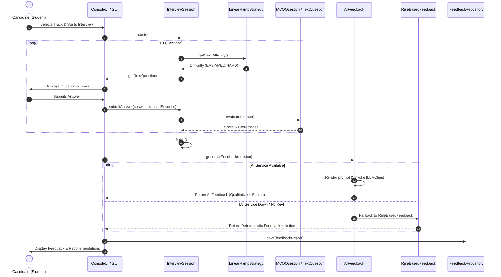

# AI Interviewer: System Architecture & Technical Specifications

---

## 1. Architectural Layers & Boundaries

The **AI Interviewer** platform is engineered using a clean multi-tiered architecture that strictly enforces the **Dependency Inversion Principle (DIP)**.

```
+-------------------------------------------------------------+
|                      Presentation Layer                      |
|   ConsoleUI (Terminal)           Qt 6 Desktop GUI (Desktop) |
+-------------------------------------------------------------+
                               |
                               v
+-------------------------------------------------------------+
|                        Service Layer                        |
|  AuthService       AdminService         InterviewSession    |
|  StreakService     DailyChallengeService NotificationService|
|  AIFeedback        FollowUpGenerator    ResumeAnalyzer      |
+-------------------------------------------------------------+
               |                               |
               v                               v
+-----------------------------+ +-----------------------------+
|        Domain Layer         | |       AI & HTTP Layer       |
| User / Student / Admin      | | ILLMClient (OpenAI/Claude)  |
| Question (MCQ/Text/Coding)  | | HttpClient (libcurl / RAII) |
| Course / Subject / Topic    | | PromptLibrary & ResponseParser|
+-----------------------------+ +-----------------------------+
               ^
               | (Implements interfaces)
+-------------------------------------------------------------+
|                      Persistence Layer                       |
|   Abstract Repositories (IUserRepository, IQuestionRepo...) |
|   - JSON Implementations (data/*.json)                      |
|   - MongoDB Implementations (mongocxx / pool)               |
+-------------------------------------------------------------+
```

### Layer Rules Enforced by CI
1. **Presentation $\rightarrow$ Service**: UI components never query database drivers, execute queries, or deserialize JSON directly. All interactions flow through high-level services.
2. **Service $\rightarrow$ Domain & Repositories**: Services coordinate business logic by operating on domain objects and calling abstract repository interfaces.
3. **Domain Independence**: Core domain models (`Question`, `User`, `Course`) have zero knowledge of databases, network clients, or UI widgets.

---

## 2. End-to-End Interview Execution Lifecycle



---

## 3. Extensibility & Developer Guide

### How to Add a New Question Type
1. Define a new header `include/core/YourQuestion.h` and source `src/core/YourQuestion.cpp`.
2. Inherit publicly from `Question`.
3. Implement `display() const override` and `evaluate(const std::string& studentAnswer) override`.
4. Update `QuestionMapper` to serialize and deserialize the new question type in JSON and BSON.
5. Zero modifications to `InterviewSession` or the interview execution engine are required!

### How to Add a New LLM Provider
1. Create `include/ai/YourProviderClient.h` inheriting from `ILLMClient`.
2. Implement `complete(const LLMRequest& request) -> LLMResponse` formatting the payload for the provider's API.
3. Register the new provider string in `LLMClientFactory::createClient()`.

### How to Add a New Leaderboard Ranking Metric
1. Inherit from `RankingStrategy` in `include/ui/RankingStrategy.h`.
2. Implement `rank(std::vector<std::shared_ptr<Student>>& candidates) const override`.
3. Add a corresponding filter option in `LeaderboardPresenter` and `ConsoleUI`.
