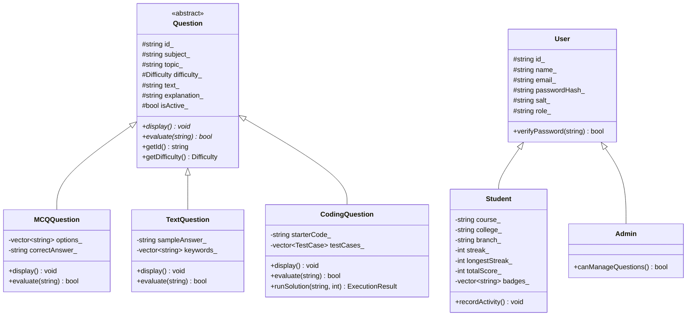
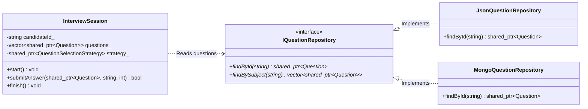
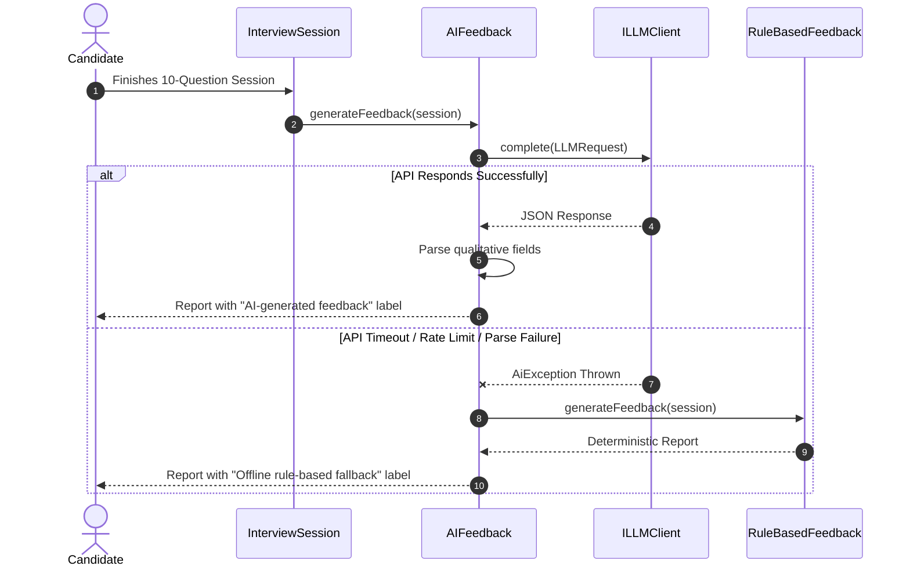
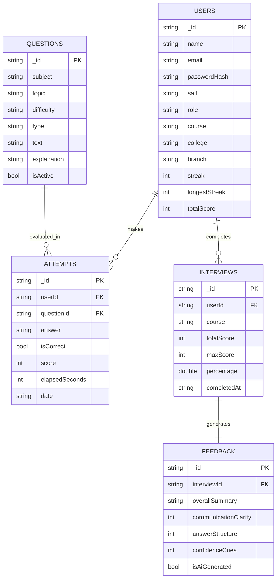

# AI Interviewer: Comprehensive UML Diagrams

This document contains Mermaid diagrams illustrating system models, execution flows, and persistence schemas.

---

## 1. Domain Layer Class Hierarchy

---

## 2. Service & Repository Layer Architecture (DIP)

---

## 3. AI Feedback Sequence with Graceful Fallback

---

## 4. Database Collections Entity-Relationship (ER) Diagram

