# AI Interviewer: UML Class Diagram & Architecture

The following Mermaid class diagram illustrates the complete Object-Oriented design and architecture across the Core domain, Authentication, Course Composition, Interview Engine, Feedback Analysis, Admin Panel, Gamification (Streaks & Badges), Daily Challenges, Leaderboard Strategies, and the Interchangeable Dual-Backend Repository Layer (JSON & MongoDB).

```mermaid
classDiagram
    direction TB

    %% ==========================================
    %% 1. Core Hierarchy (Polymorphism & Abstraction)
    %% ==========================================
    class Difficulty {
        <<enumeration>>
        EASY
        MEDIUM
        HARD
    }

    class Question {
        <<abstract>>
        #string id_
        #string subject_
        #string topic_
        #Difficulty difficulty_
        #string type_
        #string text_
        #string explanation_
        #bool isActive_
        +display()* void
        +evaluate(string)* bool
        +getId() string
        +getDifficulty() Difficulty
        +isActive() bool
        +setActive(bool) void
    }

    class MCQQuestion {
        -vector~string~ options_
        -string correctAnswer_
        +display() void
        +evaluate(string) bool
        +getOptions() vector~string~
    }

    class TextQuestion {
        -string sampleAnswer_
        -vector~string~ keywords_
        -double keywordMatchThreshold_
        +display() void
        +evaluate(string) bool
        +getKeywords() vector~string~
    }

    class CodingQuestion {
        -string starterCode_
        -vector~TestCase~ testCases_
        -int points_
        +display() void
        +evaluate(string) bool
        +runSolution(string, int) ExecutionResult
    }

    Question <|-- MCQQuestion : Inheritance
    Question <|-- TextQuestion : Inheritance
    Question <|-- CodingQuestion : Inheritance
    Question ..> Difficulty : Uses

    %% ==========================================
    %% 2. User Hierarchy (Encapsulation & Inheritance)
    %% ==========================================
    class User {
        -string id_
        -string name_
        -string email_
        -string passwordHash_
        -string salt_
        -string role_
        -string course_
        -string college_
        -string branch_
        -int streak_
        -int longestStreak_
        -string lastActiveDate_
        -vector~string~ activityDates_
        -vector~string~ bookmarks_
        +getPasswordHash() string
        +isAdmin() bool
        +incrementStreak() void
        +resetStreak() void
        +addBookmark(string) void
    }

    class Student {
        -map~Difficulty, int~ solvedByDifficulty_
        -map~string, Difficulty~ subjectUnlockedLevel_
        -set~string~ solvedChallenges_
        -vector~string~ badges_
        -int totalScore_
        -int dailyChallengesCompleted_
        +recordChallengeSolve(string, string, Difficulty, int) void
        +recordDailyChallengeCompletion(int) void
        +isLevelUnlocked(string, Difficulty) bool
        +addBadge(string) void
        +getTotalScore() int
    }

    class Admin {
        +isAdmin() bool
    }

    User <|-- Student : Inheritance
    User <|-- Admin : Inheritance

    %% ==========================================
    %% 3. Course Hierarchy (Composition)
    %% ==========================================
    class Topic {
        -string id_
        -string name_
    }

    class Subject {
        -string id_
        -string name_
        -vector~Topic~ topics_
        +addTopic(Topic) void
    }

    class Course {
        -string id_
        -string name_
        -vector~Subject~ subjects_
        +addSubject(Subject) void
        +getPreloadedCourses()$ vector~Course~
    }

    Course *-- Subject : Composition
    Subject *-- Topic : Composition

    %% ==========================================
    %% 4. Time Abstraction (DIP & Testability)
    %% ==========================================
    class IClock {
        <<interface>>
        +now()* system_clock::time_point
        +todayString()* string
    }

    class SystemClock {
        +now() system_clock::time_point
        +todayString() string
    }

    class FakeClock {
        -system_clock::time_point currentTime_
        +setTime(system_clock::time_point) void
        +advanceDays(int) void
    }

    IClock <|.. SystemClock : Implements
    IClock <|.. FakeClock : Implements

    %% ==========================================
    %% 5. Interview Engine & Question Strategies
    %% ==========================================
    class QuestionSelectionStrategy {
        <<interface>>
        +reset()* void
        +getNextDifficulty(int, vector~bool~)* Difficulty
        +selectNextQuestion(...)* shared_ptr~Question~
    }

    class LinearRampStrategy {
        +getNextDifficulty(int, vector~bool~) Difficulty
        +selectNextQuestion(...) shared_ptr~Question~
    }

    class AdaptiveStrategy {
        -Difficulty currentDifficulty_
        -int consecutiveCorrect_
        -int consecutiveWrong_
        +getNextDifficulty(int, vector~bool~) Difficulty
    }

    QuestionSelectionStrategy <|.. LinearRampStrategy : Implements
    QuestionSelectionStrategy <|.. AdaptiveStrategy : Implements

    class InterviewSession {
        -string id_
        -string userId_
        -unique_ptr~QuestionSelectionStrategy~ strategy_
        -vector~shared_ptr~Question~~ questionPool_
        -vector~SessionQuestionRecord~ records_
        +start() void
        +submitAnswer(shared_ptr~Question~, string, int) bool
        +finish() void
        +getTotalScore() int
    }

    InterviewSession o-- QuestionSelectionStrategy : Strategy
    InterviewSession o-- Question : Aggregates

    class SessionFactory {
        <<factory>>
        +createSession(SessionType, string, string, vector~shared_ptr~Question~~)$ unique_ptr~InterviewSession~
    }
    SessionFactory ..> InterviewSession : Creates

    %% ==========================================
    %% 6. Ranking & Gamification Strategies
    %% ==========================================
    class RankingStrategy {
        <<interface>>
        +getStrategyName()* string
        +getScore(Student&)* int
        +compare(Student&, Student&)* bool
    }

    class ScoreRankingStrategy {
        +getScore(Student&) int
    }
    class SolvedRankingStrategy {
        +getScore(Student&) int
    }
    class StreakRankingStrategy {
        +getScore(Student&) int
    }

    RankingStrategy <|.. ScoreRankingStrategy : Implements
    RankingStrategy <|.. SolvedRankingStrategy : Implements
    RankingStrategy <|.. StreakRankingStrategy : Implements

    class BadgeRule {
        <<abstract>>
        +evaluate(Student&, BadgeRuleContext&)* bool
        +getBadge()* Badge
    }

    class StreakBadgeRule {
        -int requiredStreak_
        +evaluate(Student&, BadgeRuleContext&) bool
    }
    class SolvedCountBadgeRule {
        -int requiredCount_
        +evaluate(Student&, BadgeRuleContext&) bool
    }
    class PerfectSessionBadgeRule {
        +evaluate(Student&, BadgeRuleContext&) bool
    }
    class DailyMasterBadgeRule {
        -int requiredCompletions_
        +evaluate(Student&, BadgeRuleContext&) bool
    }

    BadgeRule <|-- StreakBadgeRule : Inheritance
    BadgeRule <|-- SolvedCountBadgeRule : Inheritance
    BadgeRule <|-- PerfectSessionBadgeRule : Inheritance
    BadgeRule <|-- DailyMasterBadgeRule : Inheritance

    %% ==========================================
    %% 7. Services Layer
    %% ==========================================
    class AdminService {
        -shared_ptr~IUserRepository~ userRepo_
        -shared_ptr~IQuestionRepository~ questionRepo_
        -shared_ptr~IAttemptRepository~ attemptRepo_
        -shared_ptr~IQuestionFeedbackRepository~ feedbackRepo_
        +createQuestion(User&, json) shared_ptr~Question~
        +softDeleteQuestion(User&, string) bool
        +bulkImport(User&, string) ImportResult
        +getSystemStats(User&) SystemStats
        +getReportedQuestions(User&) vector~QuestionReport~
    }

    class DailyChallengeService {
        -shared_ptr~IDailyChallengeRepository~ dailyRepo_
        -shared_ptr~IQuestionRepository~ questionRepo_
        -shared_ptr~IUserRepository~ userRepo_
        -shared_ptr~IClock~ clock_
        +getTodayChallenge(string) shared_ptr~Question~
        +submitChallenge(Student&, string, string) DailyChallengeResult
    }

    class StreakService {
        -shared_ptr~IUserRepository~ userRepo_
        -shared_ptr~IClock~ clock_
        +updateUserActivity(Student&) bool
        +isStreakAtRisk(Student&) bool
        +generateMonthlyCalendar(Student&, int, int) string
    }

    class ReviewService {
        -shared_ptr~IAttemptRepository~ attemptRepo_
        -shared_ptr~IQuestionRepository~ questionRepo_
        -shared_ptr~IQuestionFeedbackRepository~ feedbackRepo_
        +getIncorrectQuestionsForRetry(string, string) vector~shared_ptr~Question~~
        +reportQuestion(string, string, string, string) void
    }

    class NotificationService {
        -shared_ptr~StreakService~ streakService_
        -shared_ptr~DailyChallengeService~ dailyService_
        +generateLoginBanner(Student&) string
    }

    %% ==========================================
    %% 8. Dual-Backend Repositories & Factory
    %% ==========================================
    class Database {
        <<singleton>>
        -static Database instance_
        -bool isConnected_
        +getInstance()$ Database&
        +connect() bool
        +ping() bool
    }

    class IUserRepository {
        <<interface>>
        +save(User&)* void
        +findById(string)* shared_ptr~User~
        +findByEmail(string)* shared_ptr~User~
        +getAllStudents()* vector~shared_ptr~Student~~
    }
    class JsonUserRepository {
        +save(User&) void
    }
    class MongoUserRepository {
        +save(User&) void
    }
    IUserRepository <|.. JsonUserRepository : Implements
    IUserRepository <|.. MongoUserRepository : Implements

    class IDailyChallengeRepository {
        <<interface>>
        +getRecord(string, string)* optional~DailyChallengeRecord~
        +saveRecord(DailyChallengeRecord&)* void
        +getUsedQuestionIds(string, int)* vector~string~
    }
    class JsonDailyChallengeRepository {
        +getRecord(...) optional~DailyChallengeRecord~
    }
    class MongoDailyChallengeRepository {
        +getRecord(...) optional~DailyChallengeRecord~
    }
    IDailyChallengeRepository <|.. JsonDailyChallengeRepository : Implements
    IDailyChallengeRepository <|.. MongoDailyChallengeRepository : Implements

    class IQuestionFeedbackRepository {
        <<interface>>
        +saveReport(QuestionReport&)* void
        +getReportsForQuestion(string)* vector~QuestionReport~
        +getAllReports()* vector~QuestionReport~
    }
    class JsonQuestionFeedbackRepository {
        +saveReport(...) void
    }
    class MongoQuestionFeedbackRepository {
        +saveReport(...) void
    }
    IQuestionFeedbackRepository <|.. JsonQuestionFeedbackRepository : Implements
    IQuestionFeedbackRepository <|.. MongoQuestionFeedbackRepository : Implements

    class RepositoryFactory {
        <<factory>>
        +createRepositories(string)$ RepositoryBundle
    }
    RepositoryFactory ..> IUserRepository : Instantiates
    RepositoryFactory ..> IDailyChallengeRepository : Instantiates
    RepositoryFactory ..> IQuestionFeedbackRepository : Instantiates
    RepositoryFactory ..> Database : Healthcheck
```

